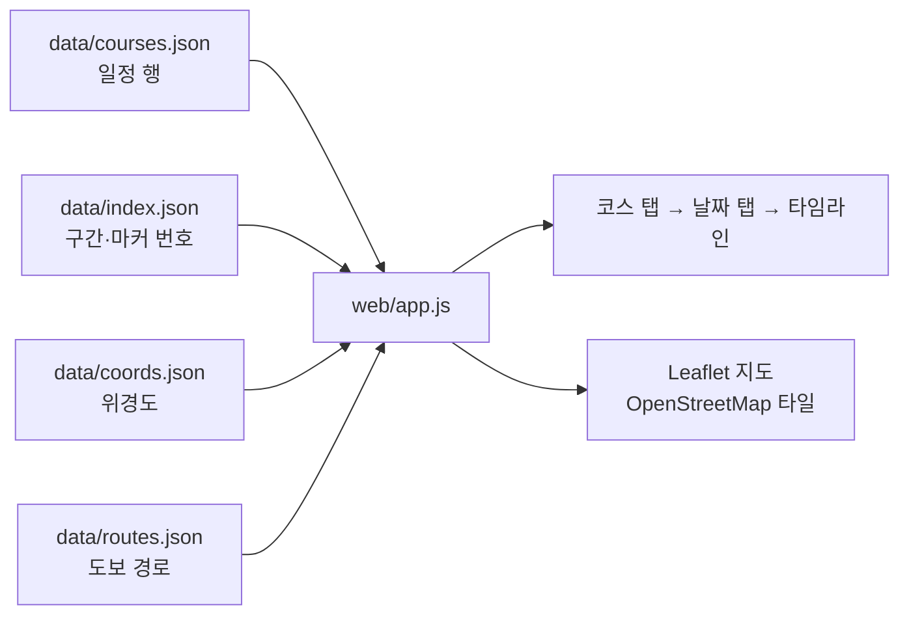

# 스페인 신혼여행 2027.05.09–05.18 · 작업 패키지

캔버스 아티팩트: https://claude.ai/artifact/GKtdAUkPMTJAEwkoy9ye1t
계획 문서(Claude Doc): https://claude.ai/artifact/BnHjHEmNBqwBe5xmc9ozpY
사이트(GitHub Pages): https://hoyoungparkme.github.io/honeymoon/ · 리포: https://github.com/HoyoungParkme/honeymoon

## 사이트 구조 (2026-11-04)

| 페이지 | 파일 | 하는 일 |
|---|---|---|
| 지구본 홈 | `index.html` | d3-geo 정사 투영 지구본(`data/land.geojson`, Natural Earth 110m). 드래그·화살표로 회전, 만지기 전엔 자전. 스페인 핀만 활성, 나머지는 흐린 핀 |
| 코스 선택 | `spain.html` | 코스 카드 3장. 누르면 총비용 막대(`data/budget.json`)와 10일 요약이 펼쳐지고 "이 코스 일정 보기"로 `web/#c{n}-d1` 진입 |
| 일정 | `web/` | 기존 일정 화면. 밝은 회백("돌") 톤 기본, 위에 지구본/스페인/코스 일정 경로 표시줄. 행을 누르면 지도 아래(폰은 행 아래)에 그 행의 예매·식당 페이지 미리보기 카드 |
| 예약할 것 | `booking.html` | 코스별 예약 체크리스트(`data/booking.json`). 항공·숙소·열차·입장권·식당 순으로 금액·예약 시점·다른 선택지·예약 링크(한국어 결제처는 "한국어", 공식은 "공식" 표시). 체크 표시는 브라우저에만 저장. 아래에 한국에서 쓰기 좋은 예약처와 택시·교통카드 준비 |
| 공통 색 | `site.css` | 홈·코스 선택의 "돌" 팔레트(회백 바탕 #F2F3F5 + 벽돌 #B8432A). `web/style.css` 라이트 토큰과 같은 값. 톤 시안: https://claude.ai/artifact/Q3usRrkiE89MiGg9Nxi9aP |

새 여행지를 넣을 땐 `index.html`의 `PINS`에 한 줄(이름·좌표·href) 추가하고, `spain.html`을 본떠 그 나라 페이지를 만들면 된다.

## 로컬 실행

이 폴더(README가 있는 곳)에서 아래를 실행하고, 브라우저로 http://localhost:8000/ 을 연다 (일정만 보려면 `/web/`).

```bash
python -m http.server 8000
```

- 파일을 더블클릭해서 열면(`file://`) 브라우저가 JSON 읽기를 막는다. 꼭 위처럼 로컬 서버로 연다.
- 주소 끝 `#c2-d5` = 코스 2의 5일차. 키보드 ← → 로 날짜를 넘긴다.
- 일정 행을 누르면 지도에서 그 장소(출발·도착)를 강조하고, 지도 마커를 누르면 해당 행으로 간다.
- 하루에 지도 구간이 여러 개면(기차로 도시 이동) 지도 위 탭으로 바꾼다. 행을 누르면 자동으로 바뀐다.



| 파일 | 하는 일 |
|---|---|
| `web/index.html` | 일정 화면 뼈대 (경로 표시줄, 코스·날짜 탭, 일정 칸, 지도 칸) |
| `web/app.js` | 데이터 4개를 읽어 화면을 그림. 원화 환산 `won()`·요금 분해 `splitFare()`는 보드 템플릿과 같은 규칙 |
| `web/style.css` | 보드와 같은 색. 폭 1000px 미만(폰)은 지도를 위에 고정하고 일정만 스크롤. 다크 모드 지원 |
| `web/tiles/` | 아티팩트용 내장 지도 타일 (JPEG 묶음 17장 + `atlas.json`). 아티팩트는 외부 지도 서버를 못 불러서 미리 받아 둔다 |

**아티팩트로 발행한 것:** https://claude.ai/artifact/9r8LCZsxDFabCCSZkg2iFG (링크만으로 작동, 비공개). 로컬에서 `?atlas` 를 붙이면 내장 타일로 똑같이 확인할 수 있다.

일정(장소·경로)이 바뀌어 지도 범위가 달라지면 타일을 다시 만든다:

```bash
python -I tools/fetch_tiles.py tools/tiles.json <타일_저장_폴더>
```

```bash
python -I tools/build_atlas.py <타일_저장_폴더> web
```

`tools/tiles.json`(받을 타일 목록, 줌 12–16)은 `data/index.json`·`coords.json`·`routes.json`에서 계산한 것이라 장소가 바뀌면 다시 계산해야 한다.

## 폴더 구성

| 폴더 | 내용 |
|---|---|
| `web/` | 웹앱 (위 "웹앱 실행" 참고) |
| `artifact/project/` | 캔버스 보드 원본 20장 (`Main`, `Transit`, `C{코스}P{페이지}.dc.html`) + `canvas.json` 배치 |
| `data/courses.json` | **웹개발용 단일 JSON.** 코스 3개 × 10일, 행마다 시각·교통편·노선·요금(유로 원문)·구글지도 링크·출처 링크. `maps[].file`, `photo.file`이 zip 안 이미지 경로 |
| `data/coords.json` | 장소 107곳 위경도 (Nominatim 지오코딩) |
| `data/routes.json` | 도보 구간 실제 경로 폴리라인 캐시 (OSRM foot) |
| `data/index.json` | 지도 파일 ↔ 코스/일차/구간/마커 번호 대응표 |
| `maps/` | 일차별 경로 지도 52장 (2026-11-04 18장 재생성) (JPG, 1200×640, OpenStreetMap 타일) |
| `photos/` | 랜드마크 사진 17장 (Wikimedia Commons, 저작자는 `credits.json`) |
| `tools/itinerary.py` | **원본 데이터.** 날짜별 `mv()`(이동)/`st()`(체류) 목록, 시각은 `add_times()`가 순서대로 계산 |
| `tools/places.py` | 장소 키 → 한글명·주소 |
| `tools/build_boards.py` | itinerary → 보드 HTML 생성 (Playwright로 높이 측정 후 8000px 단위로 분할) |
| `tools/board_template.dc.html` | 보드 템플릿 (원화 변환 `won()`, 요금 분해 `splitFare()` 포함) |
| `tools/render_maps.py` | Leaflet + Playwright로 지도 PNG 렌더 |
| `tools/build_booking.py` | 코스별 예약 목록 → `data/booking.json`. 숙소는 `courses.json`의 잠자리에서 자동(체크인·박수·아고다/부킹/트립닷컴 날짜 링크), 항공·열차·입장권·식당·택시는 파일 안 표를 손으로 고친다 |
| `tools/fetch_previews.py` | 일정 행의 예매·식당 링크를 Playwright로 열어 `previews/*.jpg` 스크린샷과 제목을 `data/previews.json`에 저장. 새 링크만 받으니 링크를 추가하면 다시 실행 |

## 결정 사항

- 목적지 스페인. 마드리드 IN · 바르셀로나 OUT(코스 1·2) / 마드리드 IN·OUT(코스 3). 관광 빡세게, 4성 위주 + 특별한 밤 1–2번.
- 총예산 1,000만 원(항공 포함, 2인). 설계 당시엔 세 코스 모두 그 아래였으나, 2026-11-04 구글 항공 조회가로는 직항 코스 2(1,038만)·3(1,025만)이 2~4% 넘는다. 코스 1(경유)은 970만.
  - 코스 1 스페인 일주 (경유 항공, 카타르항공) — 4성 숙소 + 그라나다 하맘
  - 코스 2 스페인 일주 (직항, 가성비 3성 섞음)
  - 코스 3 안달루시아 + 세고비아 (직항, 파라도르 1박)
- 표기: 전부 원화 (1€=1,500원, $1=1,330원 고정 환율), 1인 기준. 숙소는 2인 1실 카약 검색가.
- 보드 형식: 날마다 기상 시각 → 아침 A(호텔 조식)/B(동네 카페) → 출발 → 지도 이미지(마커 번호 = 표 번호) → 시각별 행(교통편·노선·방면·승하차역·소요·요금·구글지도 길찾기·예매 링크) → 하루 비용 합계.
- 요금 칸: "합계 굵게 + 항목별 한 줄 + 회색 설명" 구조.
- 교통카드: 마드리드 Multi 카드 + 10회권, 바르셀로나 T-casual, 그라나다 버스 현금/카드, 세비야 도보 위주.

## 여행사 자료 참고 반영 (2026-11-04)

구글 드라이브 `꿀배/가야투어` 일정표(마드리드2·세비야2·그라나다1·바르셀로나4)와 `꿀배/허니문리조트` 견적(스페인+포르투갈 10박)의 관광지를 세 코스와 비교해, 빠져 있던 곳만 끼워 넣었다. 하루 시간표는 `add_times()`가 다시 계산했고 고정 시각(입장 슬롯·공연·버스)은 전부 지켜진다.

| 도시 | 여행사 코스에 있는데 우리 일정에 없던 곳 | 넣은 자리 | 추가 비용(1인) |
|---|---|---|---|
| 마드리드 | 비야 광장, 산 미겔 시장 | 2일차 점심 뒤 → 마요르 광장 가는 길 | 시장 타파스 €5–10 |
| 세비야 | 세비야 대학교(옛 담배공장), 황금의 탑·과달키비르 강변, 투우장, 메트로폴 파라솔 | 5일차 오후 트램 구간을 강변 도보로 바꿈, 저녁 뒤 세타스 야경 | 세타스 약 €15 (미확인) |
| 그라나다 | 카를로스 5세 궁전 | 7일차 나스르 궁전 바로 뒤 (헤네랄리페·알카사바 5분씩 줄임) | 무료 |
| 바르셀로나 | 카사 밀라(외관), 선셋 세일링, 보케리아 시장, 대성당·고딕 지구 | 8일차 카사 바트요 뒤 / 9일차 저녁 전 / 10일차 아침 | 세일링 약 €45–60 (미확인) |

- 이미 들어 있던 것: 왕궁·프라도·마요르 광장·보틴, 알카사르·대성당·스페인 광장·플라멩코, 알함브라 전 구역, 가우디 4곳, 몬세라트, 벙커·바르셀로네타.
- 안 넣은 것: 캄프 누 박물관(축구 관심 없으면 생략), 바르셀로나 플라멩코(세비야에서 봄), 스냅 촬영(여행사 상품 전용).
- 참고용 가격 기준: 허니문리조트 지상비 1인 299만 원(국제선 제외, 조식·픽업·가이드 투어 2개 포함). 여행사 추천 호텔 중 Las Casas de la Judería(세비야)·Hotel Lleó(바르셀로나)는 우리 코스와 같다.
- 여행사 직항 안: 아시아나 OZ511 인천 11:50 → 바르셀로나 19:10 / 귀국 OZ9808(대한항공 운항) 리스본 22:15 → 인천 19:15+1. 마드리드 IN인 우리 코스와 다르니 항공권 예매 때 비교.

## 미확인 항목 검증 결과 (2026-11-03 조사, 11-04 반영 완료)

아래 "확인 값"이 `tools/itinerary.py`·보드·웹앱에 들어가 있다. 조식은 호텔별 문구(`BREAKFAST`)로 바뀌었다.

| 항목 | 보드 값 | 확인 값 | 출처 | 반영 |
|---|---|---|---|---|
| 대한항공 마드리드 도착 터미널 | T1 또는 T4 | **T1** (아시아나는 Aena 목록에 없음 → 항공권으로 확인) | aena.es 항공사 목록 | 코스 2·3 1일차, 코스 3 10일차 |
| Sol↔Atocha 세르카니아스 무료 | 미확인 €1.70 | **AVE·Alvia·Euromed·Intercity 표만 무료**(출발 4시간 전~도착 4시간 후). **Avant(톨레도·세고비아)는 해당 없음** → 톨레도·세고비아 날은 €1.70 그대로, 코르도바 AVE 날(4일차)과 그라나다→마드리드 AVE 날(코스 3 8일차)은 €0 | renfe.com 조건(normativa) | 코스 2·3 3·4·8·9일차 |
| 톨레도 시내버스 | 약 €1.50 | **€1.40** (2026.3 개편은 정기권·거주자 할인만 변경, 1회권 동일) | unauto.es/tarifas | 3일차 |
| 세고비아 11번 버스 | €2.00 | **€2.25** (AVE역 연결 11·12번 전용 요금. 일반 노선은 €1.15) | segovia.es 교통 안내 | 코스 3 9일차 |
| 그라나다 고속철(AVE) 운행 | 재개 여부 미확인 | **2026-02-17 재개** (Adamuz 사고로 1월 중단 → 복구). 마드리드–그라나다 정상 운행 | RTVE 2026-02-16, Renfe 공지 | 코스 3 8일차 (변경 없음) |
| 바르셀로나 24번 버스 정류장 | 이름 미확인 | **"Ctra. del Carmel – Albert Llanas"** (TMB 정류장명 그대로). 바로 앞 정류장은 "C N Catalunya – Park Güell" | TMB·Transit 노선표 | 코스 1·2 8일차 (이름만 확정) |
| 부엘링 GRX→BCN | 16:30경, 수하물 미확인 | 하루 평균 4편(09:05~22:55 사이), 5월 초 편도 **€41부터**. 위탁수하물 25kg **웹 €18–99**(공항 €50–160), Optima 요금엔 포함 | vueling.com, flightconnections | 코스 1·2 7일차 |
| 알함브라 나스르 궁전 예매 | 3개월 전 오픈 | 공식: 전날 23:59까지 온라인 예매, 1인·카드당 월 10장 한도, **표에 찍힌 시각에만 입장**. 일반권 **€22.27** + 수수료. 판매 개시 시점은 공식 페이지에 없음 → 2027.5 날짜가 열리는지 tickets.alhambra-patronato.es 에서 수시 확인 | alhambra-patronato.es | 코스 1·2·3 7일차 (요금 확인) |
| 호텔 조식 | €12–20 추정 | 공식 사이트엔 요금 미게시(예약 시 옵션). 확인된 것: Regente **€11.95**, Porcel Alixares **약 €16**, Casa del Capitel Nazarí는 **공식 사이트 예약 시 포함**. 나머지(Room Mate Alba, Las Casas de la Judería, Rey Alfonso X, Catalonia Catedral, Lleó, Parador)는 유료 옵션, 금액은 예약 화면에서 확인 | 각 호텔 공식 사이트 | 조식 A 문구 |
| 국제선 항공 (코스 1) | 1인 116.4만 | **1인 121.1만** (카타르 ICN→MAD 5/9 · BCN→ICN 5/18, 다구간 최저가) | 구글 항공 2026-11-04 | budget.json·Main 보드 |
| 국제선 항공 (코스 2) | 1인 186.9만 | **1인 213.4만** (대한항공·아시아나 직항 다구간 MAD IN·BCN OUT) | 구글 항공 2026-11-04 | 총액 1,038만 → 예산 초과 |
| 국제선 항공 (코스 3) | 1인 176.6만 | **1인 195.3만** (대한항공 MAD 왕복 직항 5/9–18) | 구글 항공 2026-11-04 | 총액 1,025만 → 예산 초과 |
| 숙소 2027.05 요금 | 카약 검색가 추정 | Booking.com에 2027년 5월 재고가 열린 곳은 Porcel Alixares(5/14 1박 **€90**, 조식 포함, 무료취소)뿐. 나머지 8곳 미오픈 | Booking.com 2026-11-04 | Alixares 가격만 갱신, 나머지 추정 유지 |

## 남은 할 일

1. ~~웹앱 개발~~ → 완료 (2026-11-03, `web/`). 남은 것: `photos/cibeles.jpg` 누락(해당 날은 사진 없이 표시).
2. ~~캔버스 보드 실제 렌더링 눈으로 확인~~ → 완료 (2026-11-03, Chrome에서 19장 전부 확인). 지도 52장·사진 13장 모두 표시, 잘린 보드 없음.
3. ~~미확인 항목 검증 → 반영~~ → 완료 (2026-11-04, 보드 20장·웹앱 재발행).
4. ~~항공권·숙소 실제 예약 시점 가격으로 Main 보드 예산표 갱신~~ → 항공은 2026-11-04 구글 항공 조회가로 반영 완료(아래 표). 숙소는 2027년 5월 재고가 아직 안 열려(Booking.com 9곳 중 Porcel Alixares만 €90·조식 포함 확인) 추정치 유지 → 2026년 12월 이후 다시 확인. 허니문리조트 지상비 1인 299만 원(국제선 제외)과 비교하면 우리 코스 지상비는 1인 약 300만 원 안팎으로 비슷하다.
5. ~~사이트 배포~~ → 완료 (2026-11-04). 리포 `HoyoungParkme/honeymoon`(여행지가 늘어도 쓰게 범용 이름), GitHub Pages는 main 브랜치 루트. 루트 `index.html`이 `web/`로 넘긴다. 다른 여행지를 넣을 땐 폴더를 나누고 루트 `index.html`을 목록으로 바꾸면 된다.

## 다시 만들기 순서

일정(`tools/itinerary.py`)이나 장소(`tools/places.py`)를 고친 뒤:

```bash
python -I tools/render_maps.py
```

```bash
python -I tools/build_boards.py
```

- `render_maps.py`: 좌표 없는 새 장소를 `data/coords.json`에 넣고, 바뀐 날짜의 지도만 다시 그려 `maps/*.jpg`·`data/index.json`·`data/routes.json`을 갱신한다 (OSRM·OSM 서버 사용).
- `build_boards.py`: `data/courses.json`(웹앱)과 `artifact/project/*.dc.html`(캔버스)을 만든다. Playwright·node 필요. 새 지도는 캔버스 아티팩트에 자산으로 올린 뒤 `tools/blobs.py`의 `MAP_BLOBS`에 주소를 적어야 보드에 보인다.
